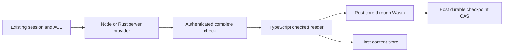

# Architecture

The existing server authenticates the caller and evaluates product permissions. The server provider converts a successful decision into a metadata-only, request-bound complete check. It does not grant permissions by itself.

`@authzflow/core` contains the state machine and a framework-neutral checked reader. The reader verifies nonce, binding, scope, resource, hash, policy and lease. It initializes from an empty authorization context after each complete check and waits for host CAS persistence before allowing a read. Restored checkpoints supply continuity for storage revision; they never grant offline access after a new process starts.

The host provides the verified session context, monotonic and wall clocks, atomic checkpoint storage, content reads and canonical hashing. Scope and resource names have no implicit prefix hierarchy. Bindings must separate tenant, principal, product and authority wherever stores could otherwise overlap.

The runtime keeps decisions in Wasm-owned state. Reads avoid serializing the complete checkpoint. Expiry pruning runs in bounded batches. Optional diagnostic events are off by default and contain fixed codes and numeric measurements rather than content, IDs or tokens.

This alpha permits one owner per checkpoint store and one in-flight checked read per reader. The checked reader returns `check_in_progress` for overlaps. Cross-process coordination is the host's responsibility. A failed commit or discontinuous clock fails closed.
